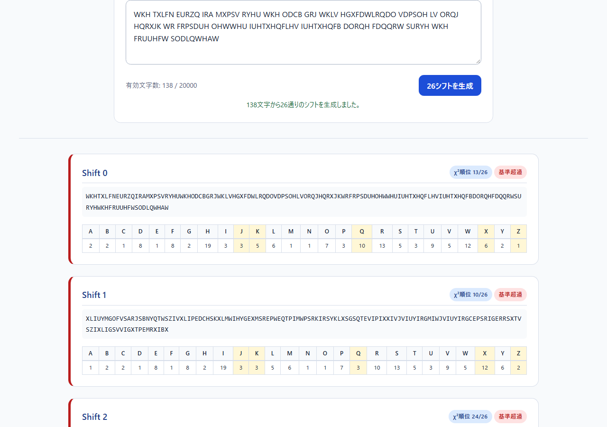
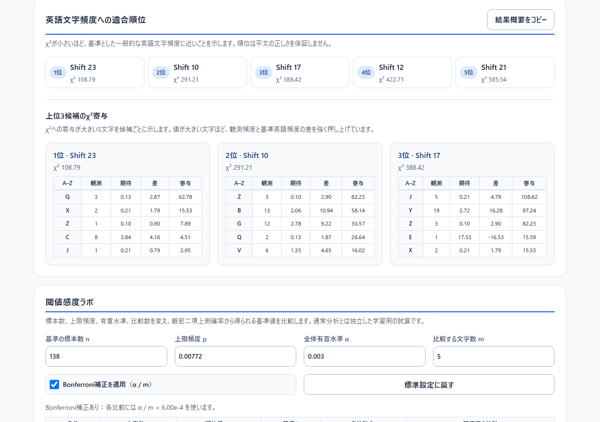
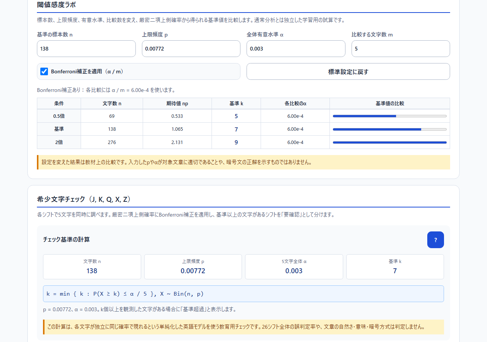

<!--
---
id: day107
slug: alphabet-shift-spectrum

title: "Alphabet Shift Spectrum"

subtitle_ja: "26シフト頻度可視化ツール"
subtitle_en: "26-Shift Frequency Visualizer"

description_ja: "Caesar暗号の26通りのシフトを一覧化し、文字頻度ヒートマップ、カイ二乗寄与、厳密二項分布による希少文字チェックと閾値感度を比較できる学習ツール。"
description_en: "An educational tool for comparing all 26 Caesar shifts with a frequency heatmap, chi-square contributions, an exact-binomial rare-letter screen, and threshold sensitivity analysis."

category_ja:
  - 暗号解析
  - 古典暗号
category_en:
  - Cryptanalysis
  - Classical Cryptography

difficulty: 3

tags:
  - Caesar cipher
  - frequency analysis
  - binomial distribution
  - chi-square
  - vanilla JavaScript

repo_url: "https://github.com/ipusiron/alphabet-shift-spectrum"
demo_url: "https://ipusiron.github.io/alphabet-shift-spectrum/"

hub: true
---
-->

# Alphabet Shift Spectrum - 26シフト頻度可視化ツール


[](https://ipusiron.github.io/alphabet-shift-spectrum/)

**Day107 - 生成AIで作るセキュリティツール200**

[English](README.en.md)

**Alphabet Shift Spectrum**は、Caesar暗号などの26通りのアルファベットシフトを比較する学習用Webツールです。シフト結果、A～Zの出現回数、ヒートマップ、英語文字頻度へのカイ二乗順位と文字別寄与、希少文字のチェック結果を同じ入力から確認できます。閾値感度ラボでは、通常分析とは分けて統計条件の違いを試せます。

順位やチェック結果は、正しい平文や鍵を自動判定するものではありません。短文、固有名詞、英語以外の文章では特に不安定になるため、実際の語や文脈と併せて利用してください。

---

## 🌐 デモページ

👉 **[https://ipusiron.github.io/alphabet-shift-spectrum/](https://ipusiron.github.io/alphabet-shift-spectrum/)**

ブラウザーで直接お試しいただけます。入力内容は外部へ送信されず、ブラウザー内だけで処理されます。

---

## 📸 スクリーンショット

>
>
>*26通りのシフトとA～Zの出現回数*

>
>
>*上位5件の順位と、上位3候補でχ²を押し上げた文字の内訳*

>
>
>*標本数、上限頻度、有意水準、比較数による厳密二項閾値の変化*

---

## ✨ 機能

### シフト一覧

- 入力へ0～25を加えた26通りのシフト結果
- 各シフトにおけるA～Zの出現回数
- 希少文字チェックの「基準内」「基準超過」表示
- 英語文字頻度へのカイ二乗順位

### 分析

- 26シフト×26文字の頻度ヒートマップ
- 一般的な英語文字頻度に対するカイ二乗値の上位5件
- 上位3候補について、χ²への寄与が大きい5文字の観測値・期待値・差・寄与
- J、K、Q、X、Zを対象とする希少文字チェック
- 厳密二項上側確率とBonferroni補正による基準値
- `n`、`p`、`α`、比較数、補正有無を変えられる閾値感度ラボ
- 入力本文を含めない分析概要のコピーと、権限拒否時の手動コピー欄
- 日本語／英語の画面切り替え

未実装のタブは表示していません。

---

## 📖 使い方

1. 暗号文を入力します。分析対象はASCII英字A～Zで、空白、数字、記号などは除外されます。
2. 「26シフトを生成」を押します。
3. 「シフト一覧」で、実際の文字列、カイ二乗順位、希少文字チェックを比較します。
4. 「分析」で、ヒートマップ、上位5件、上位3候補の文字別寄与、チェック基準と結果を確認します。
5. 必要に応じて「閾値感度ラボ」の条件を変更し、標本数や多重比較補正による基準値の違いを比べます。
6. 「結果概要をコピー」を使うと、入力本文を含めずに条件と結果だけを共有できます。
7. 順位だけで決めず、読める語、文法、文脈を人が確認します。

入力を変更すると古い分析結果は消えます。現在の入力に対して再生成してください。有効英字の上限は20,000文字です。

---

## 🔬 計算方法

### シフト

画面の`Shift s`は、入力中の各文字へ`+s (mod 26)`を適用した結果です。たとえば`KHOOR`へ`Shift 23`を適用すると`HELLO`になります。

### カイ二乗順位

各シフトのA～Z出現回数を一般的な英語文字頻度と比較し、次の値を計算します。

```text
χ² = Σ (観測回数 - 期待回数)² / 期待回数
```

値が小さいほど基準分布に近いことを示しますが、最小のシフトが正解とは限りません。短文や特殊な語彙では順位が大きく変わります。上位3候補では、各文字の項を大きい順に示し、どの観測値と期待値の差が合計χ²を押し上げたかを追跡できます。

### 希少文字チェック

J、K、Q、X、Zの5文字を同時に調べます。5文字中で最大の基準頻度`p = 0.00772`を共通の上限モデルとして使い、二項分布の上側確率を直接計算します。

```text
k = min { k : P(X ≥ k) ≤ α / 5 }
X ~ Bin(n, p),  p = 0.00772,  α = 0.003
```

5文字のいずれかが`k`回以上なら、そのシフトを「基準超過・要確認」と表示します。たとえば有効英字100文字では`k = 6`、1,000文字では`k = 19`です。

二項分布の標準偏差は`√(np(1-p))`です。ただし本ツールは基準値の算出に正規近似を使わず、厳密な離散確率を数値計算します。5文字を同時に見るため、各文字の上側確率には`α / 5`のBonferroni補正を適用します。

### 閾値感度ラボ

基準の標本数`n`に対して、0.5倍、基準、2倍の3条件を同じ`p`、`α`、比較数で計算します。Bonferroni補正を外した場合は各比較へ`α`をそのまま使い、補正した場合は`α / m`を使います。

ラボの値は通常の希少文字チェックを書き換えません。利用者が指定した`p`や`α`が対象文章に適切であることを検証する機能でもありません。

---

## ⚠️ 読み方と限界

- 「基準超過」は候補を捨てる命令ではなく、再確認を促す印である
- Bonferroni補正は各シフト内の5文字に対するものであり、26シフト全体の「99.7%信頼区間」ではない
- 独立で同じ確率の文字が並ぶという単純化した英語モデルである
- 自然言語の文字には依存関係があり、文体、分野、固有名詞で頻度が変わる
- カイ二乗順位も、文章の自然さ、意味、暗号方式、正しい鍵を証明しない
- 文字別寄与が大きいことは、正解や誤りではなく、基準頻度との差が大きいことだけを示す
- 感度ラボで指定した`p`や`α`は教材上の試算条件であり、対象文章に適切だとは限らない
- Caesar暗号以外の方式では、一覧中に正しい平文が存在しない場合がある

本ツールは、統計的な観察材料を並べる教育用ツールです。暗号解読の証明や自動判定には使用できません。

---

## 🎯 ユースケース

### このツールならではの使い方

- **異なる指標の不一致を観察する**：`KHOOR ZRUOG`のような短文では、読める`Shift 23`がカイ二乗1位にならない場合がある。文字頻度だけでは意味を判定できないことを確認できる
- **標本サイズと基準値を比較する**：感度ラボで`n`の0.5倍・基準・2倍を並べ、固定回数ではなく標本サイズを考慮する必要性を学べる
- **多重比較の影響を学ぶ**：1文字だけでなく5文字を同時に調べるため、`α`を5で割る理由を画面の計算式と解説で確認できる
- **順位の理由を追跡する**：上位3候補の文字別寄与から、たとえばQやXの観測値が期待値からどれだけ離れ、合計χ²へどれだけ加わったかを確認できる
- **頻度分布の回転を観察する**：同じ暗号文を26通りにずらし、ヒートマップの山が列方向へ移動する様子を追える

### 一般的な用途

- Caesar暗号と鍵長1のVigenère暗号の手動分析
- 文字頻度分析、二項分布、カイ二乗、多重比較の教材
- CTFやパズルの初期調査
- 頻度だけに頼る推測が外れる例の作成

関連例：[POLYALPHABETIC SUBSTITUTION PUZZLE 03【Cypher編】](https://akademeia.info/?p=36264)

---

## 🔗 参考資料

- [NIST/SEMATECH e-Handbook: Binomial Distribution](https://www.itl.nist.gov/div898/handbook/eda/section3/eda366i.htm)
- [NIST/SEMATECH e-Handbook: Bonferroni's method](https://www.itl.nist.gov/div898/handbook/prc/section4/prc473.htm)

---

## 📁 ディレクトリー構造

```text
alphabet-shift-spectrum/
├── .github/workflows/test.yml # Node.js 22の自動テスト
├── assets/                    # README用スクリーンショット
├── docs/
│   ├── DETAIL_DESIGN.md       # 詳細設計書
│   └── SCREEN_SPEC.md         # 画面仕様書
├── test/
│   ├── logic.test.js          # 計算コアの回帰テスト
│   └── ui-contract.test.js    # 日英UI・CSP・文書契約テスト
├── scripts/browser-smoke.mjs  # Chromium系ブラウザーの任意スモークテスト
├── favicon.svg                # サイトアイコン
├── index.html                 # 画面構造とCSP
├── logic.js                   # シフト・頻度・統計計算コア
├── messages.js                # 日本語／英語メッセージ
├── script.js                  # 画面描画と操作
├── style.css                  # 共通スタイル
├── style-mobile.css           # モバイル基準のレイアウト
├── style-tablet.css           # 600px以上の拡張
├── style-laptop.css           # 900px以上の拡張
├── package.json               # テストコマンド
├── README.md                  # 日本語版
├── README.en.md               # 英語版
├── CLAUDE.md                  # 開発時の規則
└── LICENSE                    # MIT License
```

---

## 💻 動作環境

- モダンブラウザー（Chrome、Firefox、Safari、Edge）
- JavaScript有効
- 外部ライブラリー、ビルド処理、サーバー通信は不要
- `index.html`を直接開く`file://`環境でも利用可能

テストはNode.js 22で`npm test`を実行します。依存パッケージのインストールは不要です。

---

## 📄 ライセンス

- ソースコードのライセンスは`LICENSE`ファイルを参照してください（MIT License）。

---

## 🛠️ このツールについて

本ツールは、「生成AIで作るセキュリティツール200」プロジェクトの一環として開発されました。
このプロジェクトでは、AIの支援を活用しながら、セキュリティに関連するさまざまなツールを100日間にわたり制作・公開していく取り組みを行っています。

プロジェクトの詳細や他のツールについては、以下のページをご覧ください。

🔗 [https://akademeia.info/?page_id=44607](https://akademeia.info/?page_id=44607)
